> [!WARNING]
> This project was **completely vibe coded** for my own purposes and has not
> been extensively tested. It may not work on your TV, firmware, certificate or
> Home Assistant setup. Use it at your own risk.

# Aurora

An Apple TV inspired launcher for Samsung Tizen TVs. One dark, quiet home
surface for HDMI inputs, Live TV, an EPG grid, native Home Assistant widgets and cameras —
designed to sit on top of the TV's own input handling rather than pretending
Tizen is something it is not.

```
HDMI 1   HDMI 2   HDMI 3   HDMI 4   Live TV   TV Guide   Home Assistant   Music   Cameras   Settings   TV Settings
```

- Focus-first TV UI (remote arrows, OK, Back) with a web-preview fallback.
- HDMI 1–4, Live TV, configurable labels and native input switching.
- HDMI tiles appear only for ports reported as connected; detection is refreshed every 30 s.
- XMLTV guide with a 3-hour grid, channel rows, now-line and programme details.
- Native Home Assistant entity dashboard with named pages and remote-friendly widgets.
- Add or remove entities by area directly on the TV.
- Music screen for a configured HA media player: album art, track, album, artist, play/pause, previous/next and Music Assistant playlist browsing.
- Cameras tile with live HLS/RTSP feeds; Channel Up/Down switches cameras while watching.
- **On-TV web configuration**: an embedded WebAssembly HTTP server on port 8099
  lets you configure the app from any browser on the LAN — no separate server.
- **First-run setup QR**: the TV shows a scannable URL with the access token
  already embedded; the browser page opens pre-authenticated.
- **TV Settings tile**: opens the TV's native picture, sound and network menu.
- **Translucent home overlay**: the current TV/HDMI source stays visible behind
  a full-screen translucent launcher; the guide keeps a compact top-right
  native preview.
- Optional multi-TV LAN configuration server for provisioning many sets.
- Runs from a plain web package: no bundler, no framework, no external assets.

## Screens

Home, guide, settings, native Home Assistant widgets, entity browser and cameras (demo data shown):

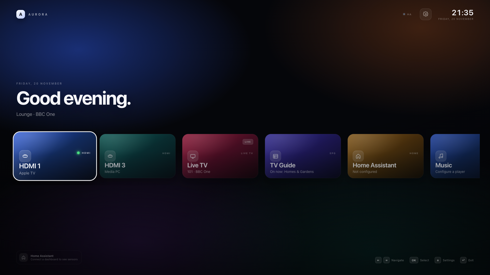
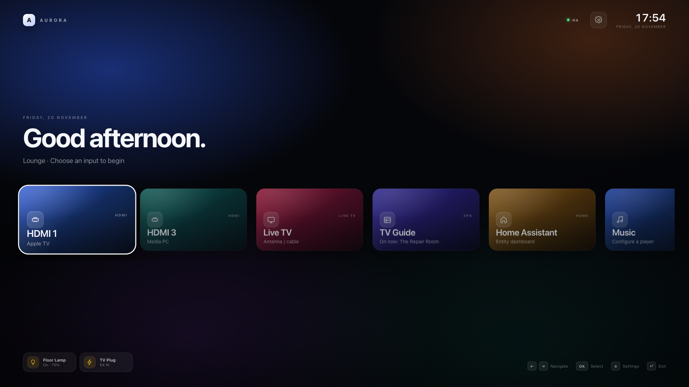
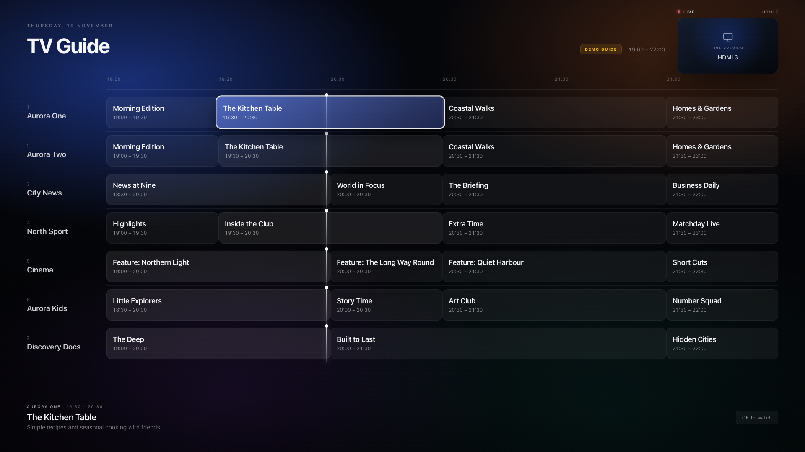
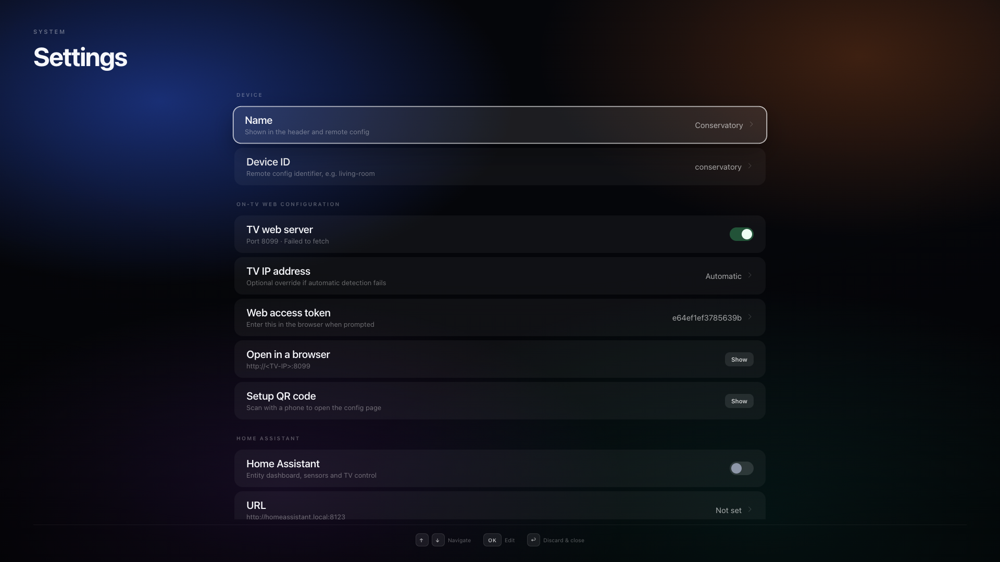
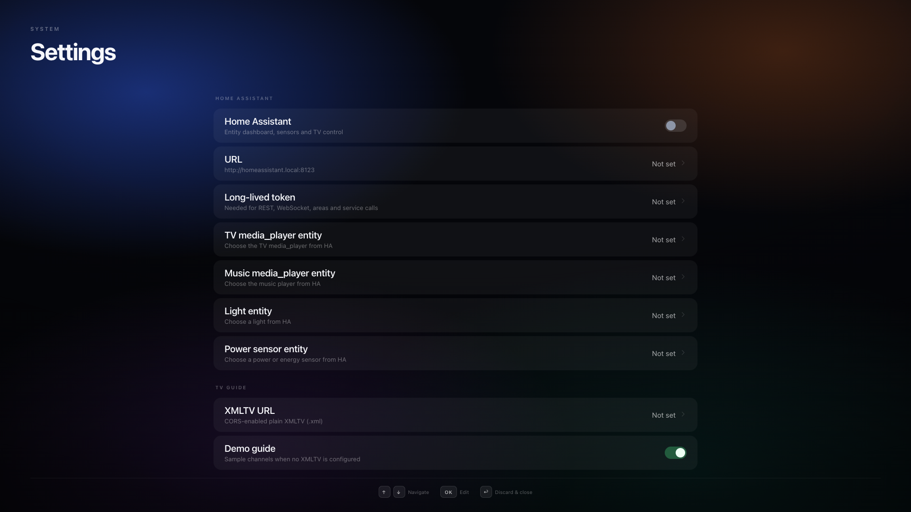
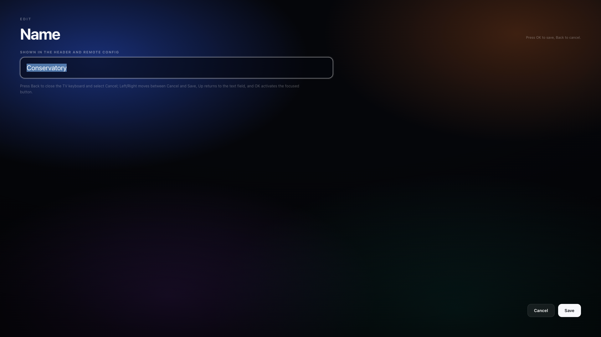
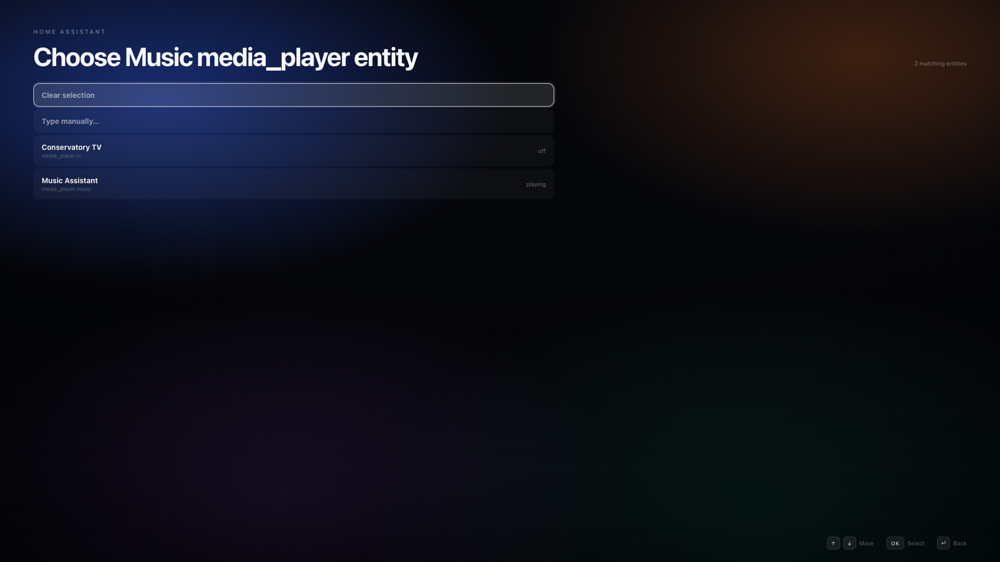
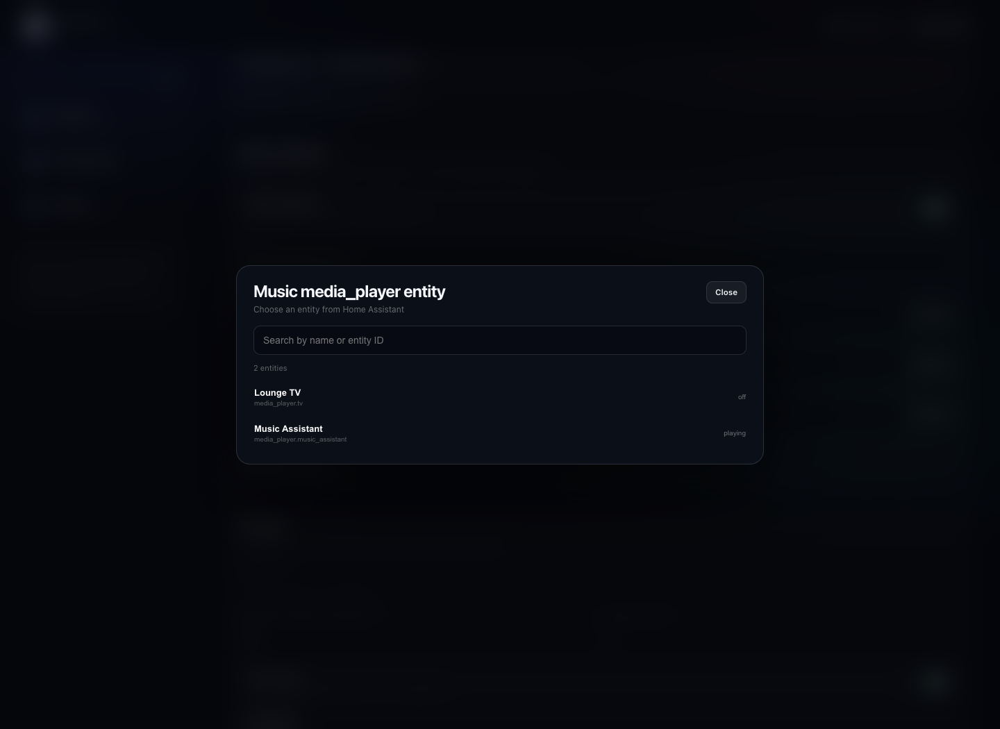
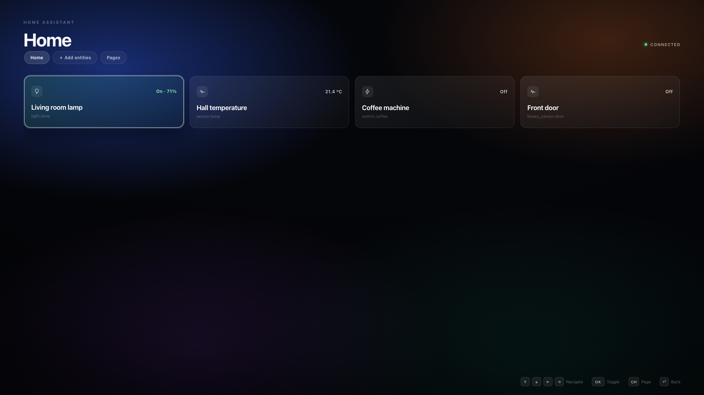
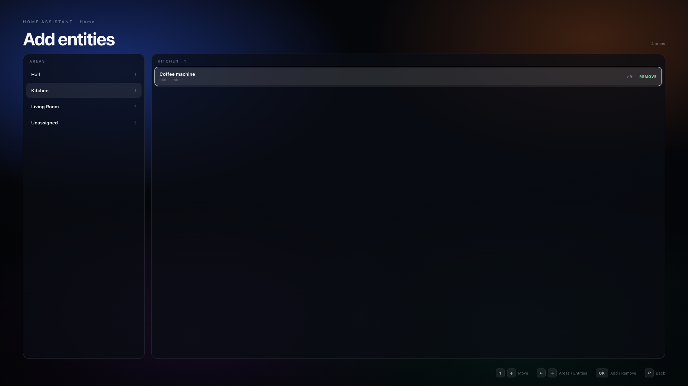
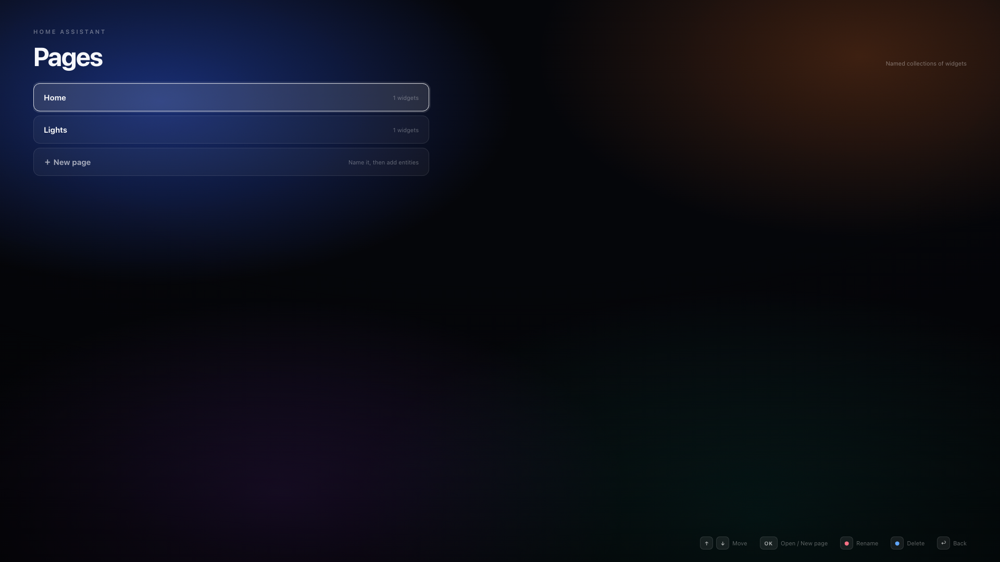
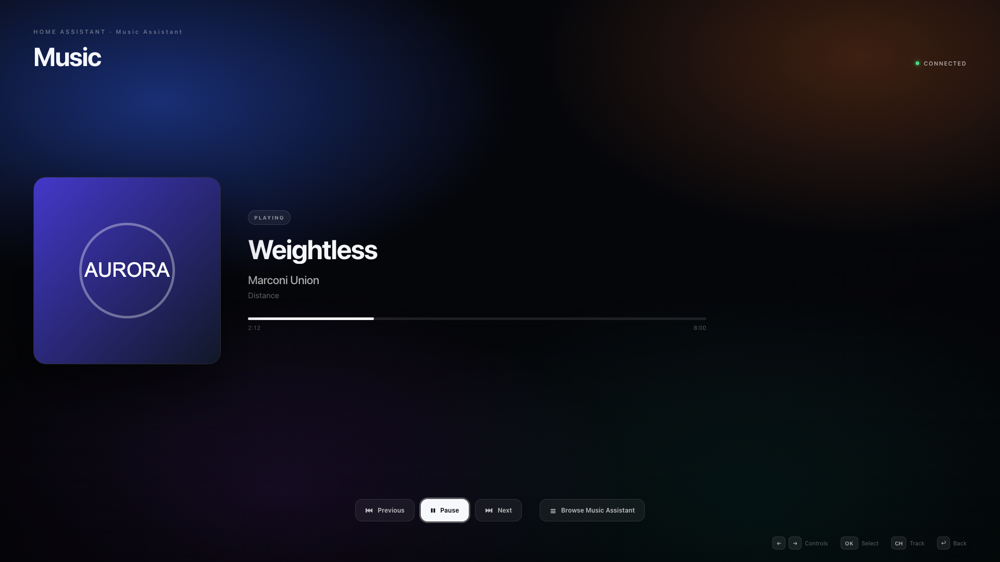
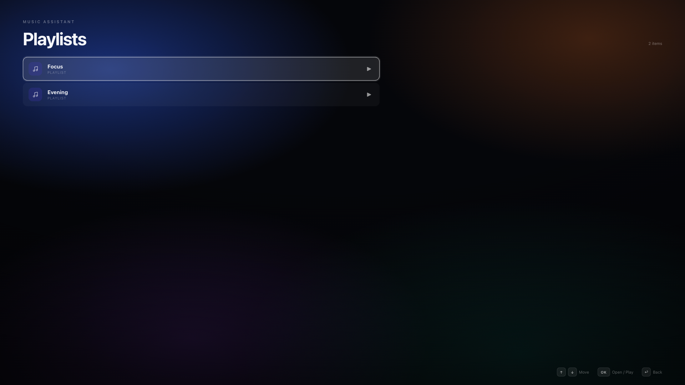
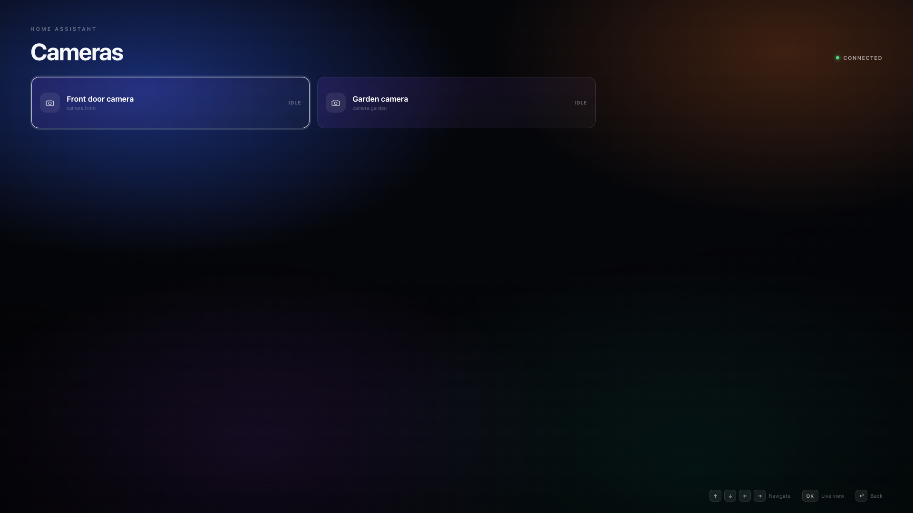
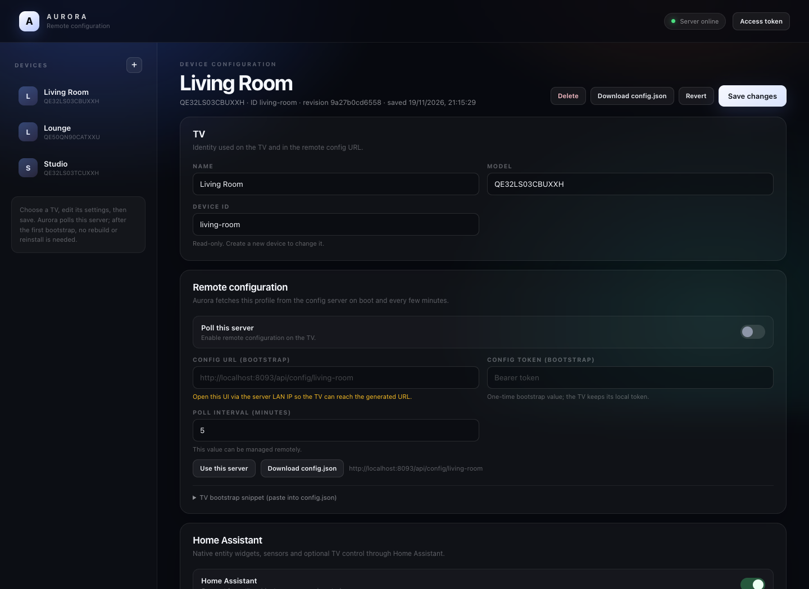
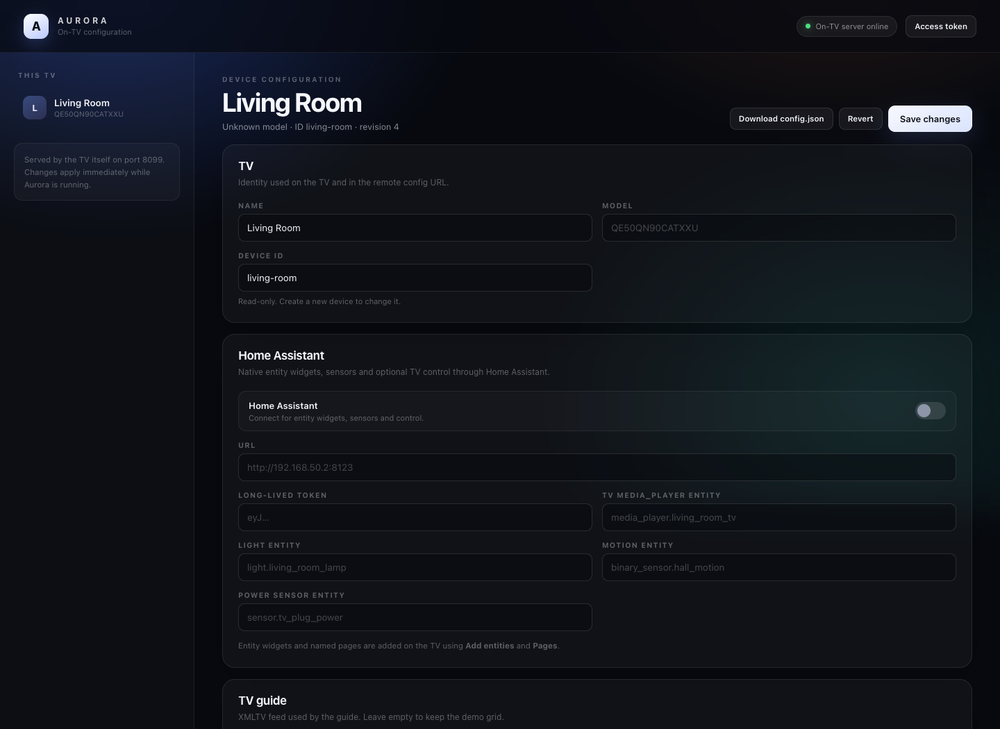
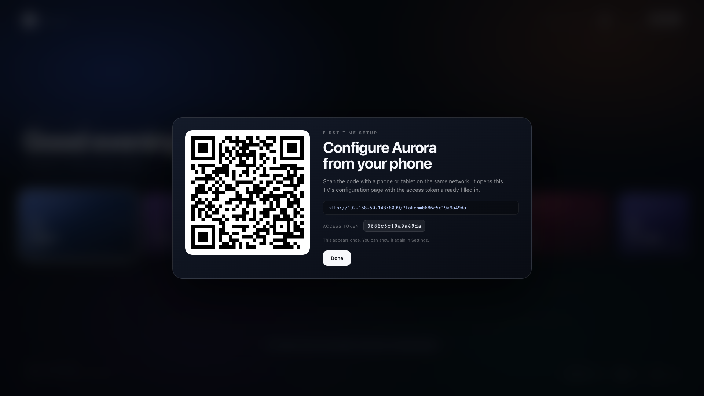

---

## Read this first: what Tizen permits

Samsung does **not** allow a retail TV app to replace the built-in Smart Hub
launcher. There is no public auto-start API, no "default launcher" setting, and
the remote's Home key always returns to Samsung's home screen. Anyone claiming
otherwise is usually relying on a rooted TV or a hotel/B2B firmware.

Aurora is therefore built as a **kiosk-style launcher app**:

| Goal | Status | How Aurora handles it |
| --- | --- | --- |
| Show a custom home screen | Works | Install and launch the app; add it to the Home bar. |
| Start automatically on power-on | Not supported on retail firmware | Use hotel/standalone mode if your TV exposes it, otherwise launch from the Home bar. |
| Replace the Samsung launcher | Not possible on retail firmware | No supported API. Do not expect the Home key to open Aurora. |
| Switch to HDMI | TVWindow | `tizen.tvwindow.setSource()` changes the main source behind the translucent home overlay; Back returns to it. |
| Tune Live TV | Model/certificate-dependent | Optional native `tizen.tvchannel` tune, then TVWindow selects the TV source. |
| Power the TV off/on | Needs Home Assistant | The web app cannot power off its own TV. Home Assistant can control a configured `media_player`. |
| Show Home Assistant while watching HDMI | Only while Aurora is foreground | Tizen gives no overlay API over other apps. Open the Home Assistant tile to show the native widgets. |
| Control the TV while Aurora is suspended | Via Home Assistant | Tizen suspends the web app; Home Assistant talks to the TV directly. |
| Configure from a browser | Works while Aurora is foreground | Embedded WebAssembly HTTP server on TV port 8099. |

Everything else in this README works within those limits.

---

## Compatibility

The project targets Tizen TV web apps from 5.5 onwards, with CSS fallbacks for
the older engine.

| Model | Region | Firmware in scope | Tizen |
| --- | --- | --- | --- |
| QE32LS03CBUXXH (The Frame 32, 2023) | EU | `T-KSU2ECDEUC-0090-2230.0` | 7.0 |
| QE50QN90CATXXU (Neo QLED 50, 2023) | UK | `T-PTMCDEUC-0090-2220.4` | 7.0+ (tested on 9.0) |
| QE32LS03TCUXXH (The Frame 32, 2020) | EU | `T-KSU2FDEUC-2743.0` | 5.5 |

Notes:

- The tested models expose the Tizen web runtime, WebSocket, `fetch`, `<iframe>` and
  `localStorage`. Aurora's JavaScript is ES5-compatible on purpose so older 2020
  models behave like newer ones.
- `tizen.tvchannel` and precise source switching are **privileged/partner**
  features. They may return `SecurityError` with a normal developer
  certificate. The app catches that and falls back.
- Older 2020 models have an older Blink engine. Flex `gap`, CSS `inset`, `clamp()` and
  `backdrop-filter` are feature-detected or avoided; expect slightly softer
  glass effects there.
- Firmware updates can reset developer mode. Re-enable it before deploying.

Ready-made seeds live in `configs/`:

| Model | Seed |
| --- | --- |
| QE32LS03CBUXXH | `configs/qe32ls03cbu.json` |
| QE50QN90CATXXU | `configs/qe50qn90cat.json` |
| QE32LS03TCUXXH | `configs/qe32ls03tcu.json` |

```bash
cp configs/qe50qn90cat.json config.json   # example
./tools/build.sh aurora
```

Use a distinct device ID and name for each TV. Set them in the on-TV Settings
or the web configuration UI; the optional config server stores one profile per
device ID. The bundled seeds are examples and are not tied to a particular room.

Then add Home Assistant credentials in Settings (or in the JSON).

Tested state: the UI, EPG/XMLTV parsing, Home Assistant REST+WebSocket paths,
the optional LAN server/API, live remote-config application (including from a
`file://` origin with a bearer token), and the embedded WASM HTTP server and
its browser UI were exercised on a physical test TV. Physical installation was
confirmed on the models listed above. Version 1.7 adds the full-screen setting
editor, the Home Assistant entity pickers, a per-model identity migration and
the faster no-splash startup. The Home Assistant add-on
files are validated as the same Node server, but were not container-built here
(no Docker available). Treat input switching as model-verification work (see
Troubleshooting).

---

## Project layout

```
.
├── config.xml                 Tizen TV widget manifest
├── config.json                First-run provisioning seed
├── configs/                   Ready-made seeds for the three target models
├── index.html                 Screens and script order
├── css/app.css                TV UI, focus states, fallbacks
├── icon.png                   512×512 app icon
├── js/
│   ├── util.js                DOM/format helpers, flex-gap detection
│   ├── localserver.js         Starts the on-TV server and syncs its config
│   ├── seed.js                Generated embedded config.json (offline seed)
│   ├── config.js              Defaults, localStorage, config.json merge
│   ├── platform.js            Tizen APIs, source switching strategies
│   ├── ha.js                  Home Assistant REST + WebSocket client
│   ├── hanative.js            Native HA widgets, pages, entity browser and cameras
│   ├── epg.js                 XMLTV parser + demo guide data
│   ├── ui.js                  Rendering, focus, overlays
│   └── app.js                 Navigation, guide, Home Assistant and remote config
├── localsrv/                  On-TV WebAssembly HTTP server (port 8099)
│   ├── server.c               POSIX-socket HTTP/JSON server
│   ├── server.{html,js,wasm,data}  Prebuilt WASM + embedded UI
│   └── build.sh               Rebuilds the WASM with Samsung Emscripten
├── local-ui/                  Single-TV config UI packed into the WASM
├── config-server/             Optional multi-TV LAN server + HA add-on
│   ├── config.yaml            Home Assistant add-on definition
│   ├── Dockerfile / run.sh    Home Assistant add-on container
│   ├── server.js              Zero-dependency Node server
│   ├── public/                Web interface (no build step)
│   └── data/                  Per-device config files (seeded)
└── tools/
    ├── build.sh               Stage the widget payload + package
    ├── deploy.sh              Build + sdb + tizen install helper
    ├── make-icon.py           Regenerates icon.png
    ├── make-seed.py           Embeds config.json for file:// provisioning
    └── ha-stub.html           Local dashboard used for UI previews
```

---

## Quick preview (no TV)

```bash
python3 -m http.server 8080
# open http://localhost:8080/
```

The preview uses the same UI, demo EPG and Home Assistant client. Source
switching is simulated (a toast tells you what would happen). Configure
Home Assistant in Settings to exercise the real integration.

The embedded on-TV configuration server uses the Tizen Sockets Extension and
only works inside the TV runtime; in a desktop browser its status will show an
error. Use the optional `config-server/` for desktop testing.

Regenerate the icon:

```bash
python3 tools/make-icon.py
```

---

## Build and install on a TV

### 1. Prepare Tizen Studio

1. Install **Tizen Studio** and, in Package Manager, the **TV Extensions**
   (`TV Extensions` for your SDK version).
2. In **Certificate Manager**, create a **Samsung** certificate:
   - Author certificate: your Samsung account.
   - Distributor certificate: Samsung TV.
3. Note the certificate profile name (for example `aurora`).
4. On the TV: **Apps → press 12345 → Developer mode On → enter the IP of the
   computer running Tizen Studio → OK**, then reboot the TV if prompted.
5. Connect:

```bash
sdb connect <TV-IP>:26101   # use the TV's IP
sdb devices
```

The TV may show an allow prompt. Accept it.

### 2. Build

```bash
export TIZEN="$HOME/tizen-studio/tools/ide/bin/tizen"
export SDB="$HOME/tizen-studio/tools/sdb"

"$SDB" connect <TV-IP>:26101
./tools/build.sh aurora
# → build/Aurora.wgt
```

`build.sh` stages only the widget payload (web assets, the `localsrv/` WASM
server, config and icon), so `docs/`, `config-server/` and local
credentials never enter the package. It also regenerates `js/seed.js` from `config.json`; run
`python3 tools/make-seed.py` if you edit the seed outside a build. Or do the whole build/install/launch in one go:

```bash
AURORA_CERT=aurora ./tools/deploy.sh <TV-IP>
```

### 3. Install and run

```bash
"$TIZEN" install -n build/Aurora.wgt -t <sdb-device-name>
"$TIZEN" run -p auroratv01.Aurora -t <sdb-device-name>
```

The TV app package ID is `auroratv01` (10 characters, followed by the app name
`Aurora`). Tizen TV installs are sensitive to the package ID format; keep it
10 characters if you rename the app. The app ID is `auroratv01.Aurora`.

If installation fails with a privilege/authorization error, remove
`tv.channel` (and `tv.inputdevice`) from `config.xml` and rebuild. The app will
still launch Live TV and use Home Assistant for power/source control.

Samsung public certificates cover specific TV DUIDs. If a new TV reports
`Invalid format of certificate in signature`, extend the certificate before
rebuilding:

```bash
apps2samsung-cli cert --tv <TV-IP> --prepare
./tools/build.sh aurora
```

The command signs in to Samsung once and adds the TV's DUID to the same public
certificate profile used by `tools/build.sh`.

### 4. "Make it the launcher"

Realistically:

1. Add Aurora to the Home bar, or leave it as the last-used app.
2. On hospitality/standalone firmware, set the app as the **home app / auto-run
   app** in the installer menu. `b2bapis` may also allow input control there.
3. Otherwise the remote Home key will always return to Samsung's launcher.

---

## Configuration

Two ways, in order of precedence:

1. **In-app Settings** (saved to `localStorage`).
2. **`config.json`** in the widget (used as the seed on first run or after a
   reset).

The Settings screen exposes the useful fields; `config.json` is the fastest way
to provision a TV without typing on a remote.

Settings text fields open a full-screen editor instead of a pop-up dialog. The
TV keyboard takes the arrow keys while the field is focused; press **Back** to
close the keyboard and select **Cancel**. **Left/Right** moves between Cancel
and Save, **Up** returns to the text field, and **OK** activates the focused
button.

Home Assistant entity fields have a **Choose** action in the web configuration
UI and open a full-screen picker on the TV. The picker lists only matching
entities (media players, lights or power/energy sensors), with
a searchable list in the browser. **Type manually** remains available as a
fallback.

The native entity browser lists individual Home Assistant areas; there is no
combined "all areas" entry. An area's entity list is built the first time that
area is selected, and the area/entity registries are cached for five minutes so
reopening the browser is instant.

Example seed:

```json
{
  "deviceId": "living-room",
  "deviceName": "Living Room",
  "ha": {
    "enabled": true,
    "baseUrl": "http://homeassistant.local:8123",
    "token": "eyJ…",
    "pages": [
      { "id": "home", "name": "Home", "widgets": [
        { "entity": "light.living_room_lamp" },
        { "entity": "sensor.hall_temperature" }
      ] },
      { "id": "lights", "name": "Lights", "widgets": [
        { "entity": "light.living_room_lamp" }
      ] }
    ],
    "currentPage": "home",
    "tvEntity": "media_player.living_room_tv",
    "musicEntity": "media_player.music_assistant",
    "lightEntity": "light.living_room_lamp",
    "powerEntity": "sensor.tv_plug_power"
  },
  "epg": {
    "xmltvUrl": "http://epg.local:8080/xmltv.xml",
    "demo": true,
    "refreshMinutes": 60,
    "horizonHours": 3
  },
  "sources": {
    "hdmi1": { "label": "HDMI 1", "sub": "Apple TV", "appId": "", "haSource": "HDMI1" },
    "hdmi2": { "label": "HDMI 2", "sub": "PlayStation", "appId": "", "haSource": "HDMI2" },
    "hdmi3": { "label": "HDMI 3", "sub": "Switch", "appId": "", "haSource": "HDMI3" },
    "hdmi4": { "label": "HDMI 4", "sub": "Mac mini", "appId": "", "haSource": "HDMI4" },
    "livetv": { "label": "Live TV", "sub": "Aerial", "appId": "org.tizen.tv-viewer", "haSource": "TV" }
  },
  "ui": {
    "lastExternal": "hdmi2",
    "overlayTimeoutMs": 3500
  },
  "remoteConfig": {
    "enabled": false,
    "url": "",
    "token": "",
    "pollMinutes": 5
  },
  "localServer": {
    "enabled": true,
    "token": ""
  }
}
```

`pages` is a list of named widget collections. Each widget has an `entity`
field. Pages and widgets are created on the TV with the **Add entities** and
**Pages** tabs; the web UI only edits the connection credentials.

The Home Assistant token is stored in `localStorage` in plain text on the TV.
Use a dedicated HA user with read/control access and a long-lived token.

---

## On-TV web configuration

The app includes a small HTTP server built as WebAssembly using Samsung's
Tizen Sockets Extension. It listens **on the TV itself at port 8099** while
Aurora is running, so no companion computer or container is needed.

On the **first run**, Aurora displays a QR code and a URL shaped like:

```text
http://<TV-IP>:8099/?token=<access-token>
```

Scan it with a phone or tablet on the same network. The page reads the token
from the URL and opens ready to edit — no token typing. The overlay appears once;
open it again with **Settings → On-TV web configuration → Setup QR code**.

Aurora finds the TV address from the first source that answers:

1. Samsung's `webapis.network.getIp()` when the firmware exposes it.
2. `tizen.systeminfo` `WIFI_NETWORK` and `ETHERNET_NETWORK` (these carry
   `ipAddress`; the plain `NETWORK` property only reports the connection type).
3. WebRTC host candidates on older engines.
4. The embedded server's own UDP interface probe, `getsockname()` on incoming
   connections, and the browser `Host` header, exposed as `ip` by
   `http://<TV-IP>:8099/api/health`.

If a locked-down firmware blocks all of them, set the address manually under
**Settings → On-TV web configuration → TV IP address** (for example
`<TV-IP>`). The QR code and every browser link use that value. The same
row shows the automatically detected address when it is working.

After that:

1. On the TV: **Settings → On-TV web configuration** — confirm it is on.
2. Open `http://<TV-IP>:8099/` in a browser on the LAN.
3. If the token is not in the URL, enter the **web access token** shown in
   Settings → On-TV web configuration → **Open in a browser**.
4. Edit the profile fields and press **Save changes**. The TV checks the local
   server and applies changes immediately.

The browser page is served from the TV and works on phones, tablets and
desktops. It only exposes the TV's own single profile (no multi-device sidebar).

- The server is available only while Aurora is in the foreground. If Tizen
  suspends the app for HDMI/Live TV, the port stops responding until Aurora is
  back.
- The config server's state lives in the app's `localStorage`: on each app
  start Aurora seeds the WASM server from its saved config.
- The generated token is random per installation. Rotate it in TV Settings; the
  server restarts and the browser must use the new token.
- No external dependency is required for this mode. The optional
  `config-server/` remains useful for provisioning several TVs, initial
  bootstrap, or when you want a server that runs independently of the TV app.

If port 8099 is already in use, the TV shows the error under Settings → On-TV
web configuration → Open in a browser. Rebuild with a different constant in
`localsrv/server.c` or stop the conflicting app.

The WASM binaries are checked in, so normal app builds need no Emscripten
toolchain. `tools/build.sh` repacks `local-ui/` into `localsrv/server.data`
automatically. Only changes to `localsrv/server.c` require the Samsung
Emscripten SDK (the fork with the Tizen Sockets Extension); install it,
activate it, and run
`EMSDK_BASE=/path/to/emscripten-release-bundle/emsdk ./localsrv/build.sh`.

---

## Optional LAN configuration server

The optional `config-server/` is both a dependency-free Node service (Node 18+)
and a **Home Assistant add-on** for central multi-TV provisioning. Each TV is a
JSON profile; Aurora fetches its profile on boot and every few minutes, then
applies it live.

### Home Assistant add-on

`config-server/` contains `config.yaml`, `Dockerfile` and `run.sh`, so it can be
installed directly as a local add-on:

1. Copy `config-server/` to `/addons/aurora_config/` on the Home Assistant host
   (Samba or SSH), keeping `config.yaml` at its root.
2. Open **Settings → Add-ons → Add-on store**, refresh, install **Aurora TV
   Configuration**.
3. Set `config_token` (recommended) and `public_url` (for example
   `http://<HA-IP>:8090`) in the add-on options, then start it.
4. Open the **Aurora TV** sidebar panel, or use `http://<HA-IP>:8090/`.

Profiles are stored in `/data/aurora/` inside the add-on container and survive
updates. An example profile is included in `config-server/data/example.json`;
create one profile per TV in the UI. Live profiles and local deployment notes
are git-ignored, so Home Assistant tokens never enter the repository. Point
each TV's remote configuration at the add-on:

```text
http://<HA-IP>:8090/api/config/<device-id>
```

and use the add-on's `config_token` as the bearer token. The old direct Node
mode still works unchanged for development or a non-HA host.

### Start the server

```bash
cd config-server
AURORA_CONFIG_TOKEN='choose-a-token' PORT=8090 node server.js

# or
npm start
```

Open `http://<server-lan-ip>:8090/` in a browser. Enter `AURORA_CONFIG_TOKEN`
when prompted.

- `config-server/data/` contains the tracked example profile. Live per-TV profiles are git-ignored.
- Use **Add device** to create more profiles (copying an existing one).
- Edit Home Assistant, guide, input labels/IDs and remote settings in the
  browser, then **Save changes**.
- **Download config.json** produces a ready bootstrap file with the remote URL
  and token already filled in.
- **Test Home Assistant** and **Test XMLTV** validate the endpoints from the
  server side, avoiding browser CORS issues.

### One-time bootstrapping on the TV

The TV cannot discover the config server by itself. Configure the remote URL
once, using either:

1. **On the TV:** Settings → Remote configuration → enable → enter
   `http://<server-lan-ip>:8090/api/config/<device-id>` and the token, then
   Save. Use **Sync now**.
2. **In the widget config:** paste the downloaded `config.json` over the
   project's `config.json`, rebuild and reinstall once.

After that, every saved change applies on the next poll (default 5 minutes).
You can force a check from the TV with Settings → Remote configuration → Sync
now, or by reopening the app (it syncs on boot and when it returns to the
foreground).

If the UI is opened through `localhost`, the generated URL is only usable on the
same machine. Open it through the server's LAN IP (the warning in the UI says
this), or set `AURORA_PUBLIC_URL` on the server for reverse-proxy setups.

The **config URL/token/enabled** fields are bootstrap values. Aurora refuses to
let a remote profile replace the transport it fetched over, so a stale profile
cannot disable polling or overwrite the token and lock the TV out. Change or
disable remote configuration on the TV itself; the poll interval can be managed
remotely. If you rotate `AURORA_CONFIG_TOKEN`, update the token on each TV (or
redeploy its bootstrap config).

### API

All endpoints except `/api/health` require the token as
`Authorization: Bearer <token>`, `X-Aurora-Token`, or `?token=`:

| Method | Path | Purpose |
| --- | --- | --- |
| `GET` | `/api/devices` | List profiles |
| `POST` | `/api/devices` | Create `{id,name,model,copyFrom}` |
| `DELETE` | `/api/devices/<id>` | Delete a profile |
| `GET` | `/api/config/<id>` | Full profile + `revision` + `updatedAt` |
| `PUT` | `/api/config/<id>` | Save `{config:{…}}` |
| `GET` | `/api/bootstrap/<id>` | config.json with `remoteConfig` prefilled |
| `POST` | `/api/test/ha` | `{baseUrl,token}` |
| `POST` | `/api/ha/entities` | `{baseUrl,token}` → entity names, states and device classes for the picker |
| `POST` | `/api/test/xmltv` | `{url}` |
| `GET` | `/api/health` | Unauthenticated liveness check |

The TV request is a simple cross-origin GET; the server answers CORS preflight
and exposes `ETag`. Responses are wrapped as
`{device, revision, updatedAt, config}`; a raw config object is also accepted.

### systemd

```bash
sudo mkdir -p /opt/aurora-config
sudo cp -R config-server/* /opt/aurora-config/
sudo cp config-server/aurora-config.service /etc/systemd/system/
sudo systemctl enable --now aurora-config
```

Set `AURORA_CONFIG_TOKEN` and optionally `AURORA_PUBLIC_URL` in the unit. Keep
the server on the TV VLAN; prefer a TLS reverse proxy if it is reachable from
outside.

The optional `config-server/` directory is **not** part of the TV widget package.
`tools/build.sh` stages the web assets, the embedded `localsrv/` WASM server,
`config.json` and the icon; the on-TV browser UI is preloaded inside
`localsrv/server.data` and repacked from `local-ui/` on every build.

---

## Home Assistant setup

Aurora talks to Home Assistant directly over its REST and WebSocket APIs; there
is no iframe dashboard. The long-lived token is used for both.

### CORS

Home Assistant must allow the TV’s `file://` origin (`null`) for REST calls:

```yaml
http:
  cors_allowed_origins:
    - "null"
    - "http://localhost:8080"   # preview
```

The WebSocket path is not CORS-restricted, so state updates, entity areas,
pages and camera streams work even if REST CORS is awkward. Add the origins and
restart HA.

### Entity dashboard

Open the **Home Assistant** tile. The native screen shows the current page of
widgets:

- **Left/Right/Up/Down** move focus.
- **OK** toggles lights, switches, fans, covers, locks, scenes, scripts and
  buttons; sensors open a details panel.
- **CH Up/Down** changes page.
- **Back** returns home.

Use **＋ Add entities** to browse Home Assistant by area and add or remove
entities on the current page. Area browsing uses the area, device and entity
registries over WebSocket, so the token's user must be an administrator. If the
registries are unavailable, Aurora falls back to a flat list of all entities.

Use **Pages** to create, open, rename (red key) or delete (blue key) named
pages. Pages and widgets are stored in Aurora's config, not in HA dashboards.

### Music

Set **Music media_player entity** in Settings (or the web configuration UI) to
the Home Assistant media player
that feeds the Music screen (usually a Music Assistant media player).

The Music screen shows album art, track, artist, album, playback state and
progress from the entity's attributes:

- **Left/Right** moves between Previous, Play/Pause, Next and Browse.
- **OK** activates the focused control.
- **CH Up/Down** skips to the previous/next track from anywhere on the screen.
- **Back** returns home.

The Music screen updates from Home Assistant `state_changed` events, so track,
artist, album, artwork and play state follow changes made on the TV or directly
in Home Assistant. Button actions also pull fresh state as a fallback.

**Browse Music Assistant** uses Home Assistant's
`media_player/browse_media` WebSocket command. Navigate the returned folders
(for example **Playlists**), then press OK on a playlist to play it with
`media_player.play_media`. Browsing needs the HA WebSocket connection. The
player must support `media_previous_track`, `media_next_track` and
`media_play`/`media_pause`.

### Cameras

The separate **Cameras** tile lists the `camera.*` entities that can provide a
live stream. Still-image-only cameras are hidden:

- A camera is shown when it advertises `CameraEntityFeature.STREAM` in
  `supported_features`, or has a direct `rtsp_url`, `stream_url`,
  `stream_source`, `rtsp` or `hls_url` attribute.
- If the entity has a direct stream URL, that URL is used with Samsung AVPlay.
- Otherwise Aurora asks HA's `camera/stream` WebSocket command for the HLS URL
  and prefixes the HA base URL.
- **Back** returns to the camera list.
- **Channel Up/Down** switches to the next/previous camera while watching.

Streaming needs the HA WebSocket connection. For RTSP URLs, AVPlay must support
the stream format/container on your TV model; HA's HLS camera proxy is the more
portable path.

If you use HTTPS for HA, use a certificate the TV trusts. TV apps run from
`file://`; mixed HTTP/HTTPS content can be blocked by the browser.

### Entities for the sensor strip

Set these in Settings (or `config.json`):

- `lightEntity` — any `light.*`; shows on/off/brightness.
- `powerEntity` — any `sensor.*` with a power/energy unit.
- `tvEntity` — a `media_player.*` for the Samsung TV. Enables source selection
  and power-off fallbacks through Home Assistant.

The light/power states are shown in the sensor strip.

---

## Native input switching

The HDMI tiles and the Live TV tile use the TV's native paths:

1. **TVWindow** (`tizen.tvwindow.setSource(..., 'MAIN')`) selects the main
   video source from `tizen.systeminfo` `VIDEOSOURCE`. When switching from the
   home screen, Aurora keeps its window in front and refreshes the translucent
   TV window, so the menu stays over the new input. Press **Back** to close the
   menu and watch the input full-screen. This is the primary path for HDMI 1–4
   and Live TV.
2. For Live TV, if `livetv.defaultChannel` is set and `tizen.tvchannel` is
   available, Aurora tunes that channel before selecting the TV source.
3. **B2B input API** (`b2bapis.b2bcontrol.setInputSource`) when the TV exposes
   it.
4. **Tizen app launch** as a last fallback. Live TV uses
   `org.tizen.tv-viewer`. There are no public `org.tizen.hdmi1`…`4` apps, so
   HDMI fallback is only possible on firmware that provides a real input app.

Aurora uses only these native paths; there is no network fallback in the menu.
The `tv.window` privilege is required.

At boot, on resume and every 30 seconds Aurora reads `VIDEOSOURCE` and shows
only the HDMI ports that report as connected. Unplugging a source removes its
tile; plugging one in adds it. If detection is unavailable, all four configured
HDMI tiles remain so the menu is never empty.

The HDMI and Live TV tiles show a green indicator when they are the current
input. Selecting the active input closes the menu (the same as **Back**);
selecting another input switches the TV behind the menu and leaves it open.
The Live TV tile subtitle shows the current or last known channel number and
name, and is blank when neither can be determined. HDMI tiles show the title
reported by the Home Assistant TV media player for the active input, falling
back to that input's configured subtitle when no title is available. HDMI
content is never used as a Live TV channel name.

## Live input behind the launcher

While Aurora is in the foreground, the current input stays visible in a native
`tizen.tvwindow`:

- On **Home**, a full-screen window is shown with `show(..., 'MAIN', 'BEHIND')`
  and the home screen becomes a translucent overlay over it. The home screen no
  longer has a separate preview card.
- On **TV Guide**, a compact window sits in the top-right corner above the grid,
  using `show(..., 'MAIN', 'FRONT')`.

The TV window is hidden before opening Settings/Home Assistant, showing the
setup QR, or leaving the home screen. Switching from a home tile keeps the menu
visible and updates the input behind it. If TVWindow or `BEHIND` is unavailable,
Aurora keeps the home screen opaque and falls back to hiding itself after a
source change.

Press **Back** on the home screen to leave Aurora and return to the previous
input or app. Aurora is backgrounded rather than terminated: some Tizen
firmware immediately relaunch an app that calls `exit()`, which appeared as a
reload loop. In the desktop preview, Back shows a notice instead of closing the
browser.

If a tile fails, open **Settings → Diagnostics** and check **Tizen TVWindow
input API**. The fallback app IDs are optional; leave the HDMI rows empty and
keep Live TV at `org.tizen.tv-viewer` unless diagnostics show a different
installed app ID.

---

## Native TV settings

The **TV Settings** tile opens Samsung's own settings instead of a launcher
screen. Aurora tries, in order:

1. The standard Tizen app control `http://tizen.org/appcontrol/operation/setting`.
2. Samsung `org.tizen.menu` with the regional menu JSON
   (`ATSC`, `DVB`, then a plain `menu.json`) and `__K_EX_FORCE_BOOST=enable`.
3. A direct launch of `org.tizen.menu`, then `com.samsung.tv.coba.setting`.

The first two use `tizen.application.launchAppControl()`; no extra privilege is
needed beyond `application.launch`. If the tile does nothing, check
**Settings → Diagnostics** and the TV's firmware app-control support.

---

## TV guide

- Without `epg.xmltvUrl`, Aurora generates a clearly marked **demo guide** with
  invented channels and programmes. It is decorative but fully navigable.
- With XMLTV, the guide loads the file, parses `<channel>`/`<programme>`, and
  keeps roughly the last 12 h / next 7 days.
- The guide endpoint must send `Access-Control-Allow-Origin` for the TV
  (`file://` origin is `null`). A typical nginx line:

```nginx
add_header Access-Control-Allow-Origin *;
```

- Selecting a programme tries `tizen.tvchannel` first (partner privilege). If
  tuning is unavailable, it opens Live TV. Demo channels are not real numbers;
  on a TV they open Live TV.

---

## Home Assistant recipes

### Switch the TV to an input

Use `media_player.select_source` on the `ha.tvEntity` configured in Settings.
Aurora's own HDMI tiles use native switching and do not depend on Home
Assistant.

### Show a Home Assistant page

Open the **Home Assistant** tile and use **Pages** to switch between named
widget pages. Channel Up/Down cycles pages while the screen is open. The sensor
strip remains read-only; the widget grid is the control surface.

### Toggle the lamp from the launcher

Add `light.living_room_lamp` with **Add entities**, then focus its widget and
press **OK**. Lights, switches, fans, covers, locks, scenes, scripts and buttons
are supported.

---

## Troubleshooting

**`Aurora.wgt` install fails with "privilege not granted"**
Use a Samsung TV certificate. Tizen TV also refuses packages whose package ID
is not in the expected 10-character form; this project uses `auroratv01`.
If a public certificate rejects a TV privilege, remove it from `config.xml`,
rebuild, and use Home Assistant for the affected control.

**HDMI tiles do nothing**
Inputs are not apps on every firmware. Check in order:
1. Open **Settings → Diagnostics** and confirm **Tizen TVWindow input API** is
   available.
2. Confirm `config.xml` includes `http://tizen.org/privilege/tv.window`.
3. For Live TV, set `livetv.defaultChannel` to tune before selecting TV.
4. Leave the HDMI fallback app IDs empty; there are no public
   `org.tizen.hdmi*` apps. If TVWindow is unavailable, use the B2B API or Home
   Assistant's `media_player` controls.

**TV Settings tile does nothing**
- This uses a Tizen application control; some firmware builds block it.
- The fallbacks try `org.tizen.menu` with ATSC, DVB and plain menu JSON.
- Check **Settings → Diagnostics** and update the TV firmware if no handler is
  available; the physical remote's Menu/Settings key always works.

**The home screen is opaque instead of translucent**
- TVWindow/PiP with `BEHIND` must be supported by the firmware; check
  **Settings → Diagnostics → Tizen TVWindow input API**.
- Aurora falls back to an opaque home screen when `show(..., 'BEHIND')` fails.
- The TV window is hidden while Settings, Home Assistant, dialogs or the setup
  QR overlay are open.
- On a 4K set the guide window is percentage-based; if it is misplaced, check
  the TV's PiP/overscan settings.

**An HDMI tile is missing**
- Only connected HDMI ports are shown. Check the cable, then wait up to 30 s or
  reopen Aurora.
- If `VIDEOSOURCE` detection fails, all four configured tiles are shown.
- **Settings → Diagnostics → HDMI inputs** reports the detected ports.

**HDMI works but Aurora never comes back**
Tizen suspends the app when an input app opens. Press Home and reopen Aurora, or
add it to the Home bar. Home Assistant can still control the TV directly while
Aurora is suspended.

**Home Assistant screen is empty**
- The HA tile uses the REST/WebSocket API, not an iframe. Check
  **Settings → Diagnostics** for the HA status.
- The long-lived token must be valid and the TV must reach `ha.baseUrl` by IP.
- Add widgets with **＋ Add entities**; a new page starts empty.

**Add entities shows no areas**
- Area browsing uses the HA area/device/entity registries over WebSocket. The
  token's user must be an administrator.
- If the registries are blocked, Aurora falls back to a flat **All entities**
  list.
- Restart the HA tile after changing the token.

**Music screen is empty or controls fail**
- Set **Settings → Home Assistant → Music media_player entity**.
- The entity must be a `media_player.*` that exposes track metadata and supports
  the media transport services.
- Music Assistant playlist browsing needs the HA WebSocket connection.
- Album art comes from the entity's `entity_picture`; a missing or blocked image
  falls back to a music placeholder.

**Camera list is empty or a feed fails**
- The Cameras tile lists `camera.*` entities. Add camera integrations in HA
  first.
- Live playback uses AVPlay and HA's `camera/stream` HLS URL. A camera must
  support streaming; snapshot-only cameras cannot play live.
- If the camera has a direct `rtsp_url`/`stream_url` attribute, Aurora tries it
  first; otherwise it uses HA’s HLS proxy.
- Check **Settings → Diagnostics** for the HA connection status.

**HA sensors show "Unavailable" / status is red**
- Token must be valid and allowed to read those entities.
- Set the CORS options above. Aurora uses the HA WebSocket first and falls back
  to REST polling; a green HA dot means one of them is working.
- Entity IDs are case-sensitive (`light.lamp`, not `Lamp`).

**The setup QR code does not appear or has the wrong address**
- Check **Settings → On-TV web configuration → TV IP address**. It shows the
  detected address or **Automatic**; if it shows **Automatic** and the QR is
  missing, enter the TV's address manually and press **Setup QR code** again.
- The QR is shown once per generated token. After a reinstall a new token is
  created and the QR appears again; use **Setup QR code** to force it.
- `http://<TV-IP>:8099/api/health` now also returns the address the embedded
  server sees, e.g. `{"ok":true,"service":"aurora-tv-local","ip":"<TV-IP>"}`.

**The on-TV config page does not load**
- Confirm Aurora is in the foreground; Tizen pauses the embedded server when
  another input app is active.
- Check the token shown in Settings → On-TV web configuration.
- Test `http://<TV-IP>:8099/api/health`; it should return `{"ok":true}` (plus
  `ip`).
- If the port is occupied, the app reports the bind error in Settings.

**Remote configuration does not apply**
- Confirm the TV's Settings → Remote configuration shows the right URL/token.
- Open `/api/health` in a browser; then open the config URL directly from the TV
  network and check for a 401.
- The server must be reachable by IP, not `localhost`, and port 8090 must not be
  blocked by a firewall.
- The app defers remote updates while the Settings screen or a dialog is open;
  close Settings to apply. **Sync now** forces a check.
- Settings → Remote configuration and Settings → Diagnostics show the last sync,
  revision and error.

**Guide is empty or shows demo data**
- XMLTV must be valid XML and CORS-enabled.
- Gzipped `.xml.gz` is not decompressed by the app; serve plain XML.
- Use `epg.demo: true` to keep a usable grid while fixing the feed.

**App looks cramped on the 2020 Frame**
The old engine has no flex `gap`; Aurora detects this and switches to margins.
If `backdrop-filter` is unsupported, panels become slightly more opaque. That is
expected. Updating TV firmware may improve it.

**Developer mode stopped working after a firmware update**
Re-enable it (Apps → 12345 → Developer mode, host IP) and reconnect with `sdb`.

**Logs**
Use Tizen Studio's Device Manager log view, or:

```bash
sdb dlog | grep -i aurora
```

---

## Security

- The HA long-lived token is stored in `localStorage`, in `config.json`, in the
  generated `js/seed.js`, and in `config-server/data/*.json`; treat the source
  tree, the server, the `.wgt` and the TV as trusted devices.
- The on-TV port **8099** is protected by a per-install random token. The token
  is visible in TV Settings and in the local profile. Use it whenever prompted.
- Always set `AURORA_CONFIG_TOKEN` before exposing the optional LAN server. It
  protects reads as well as writes, because profiles contain secrets.
- The on-TV server has no TLS. Keep the TV on a trusted VLAN and do not expose
  port 8099 through a router port-forward.
- Use a dedicated Home Assistant user and TLS where possible.
- Widget pages and entity IDs are stored in the same config/localStorage as the
  HA token; treat the TV and the config source as trusted devices.

---

## Licence

MIT. The Samsung and Home Assistant names are trademarks of their respective
owners; this project is not affiliated with either.
